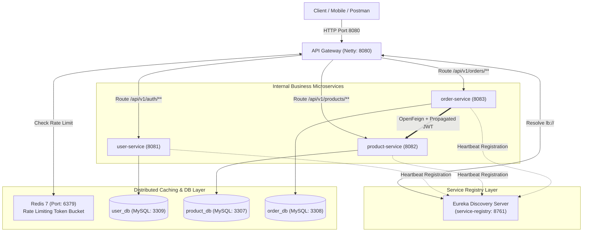
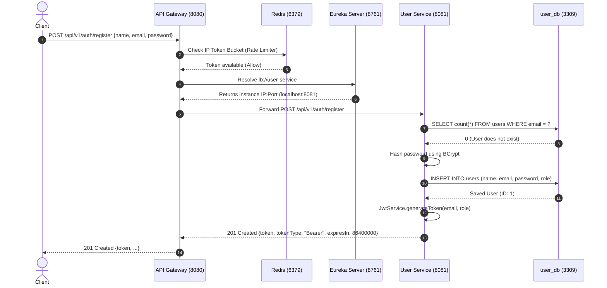
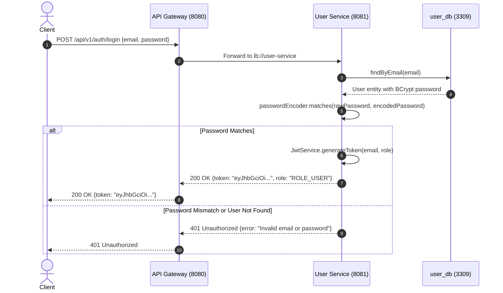
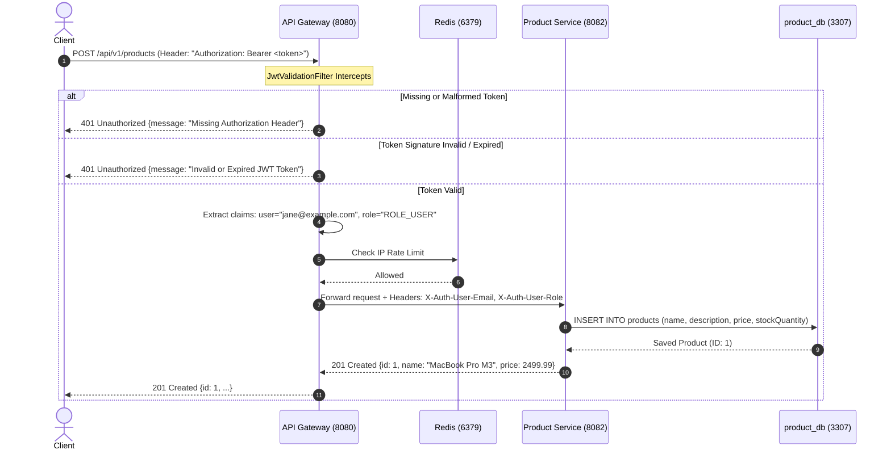
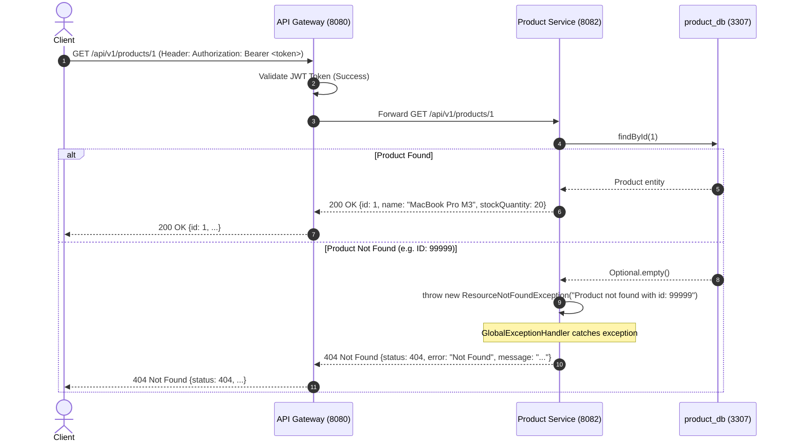
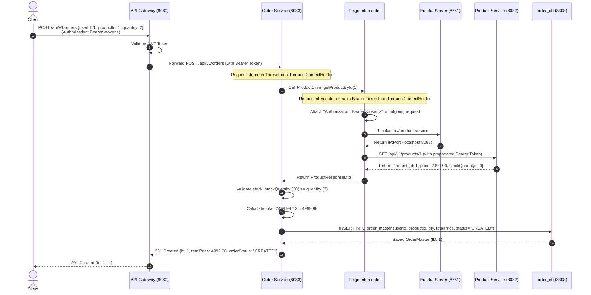
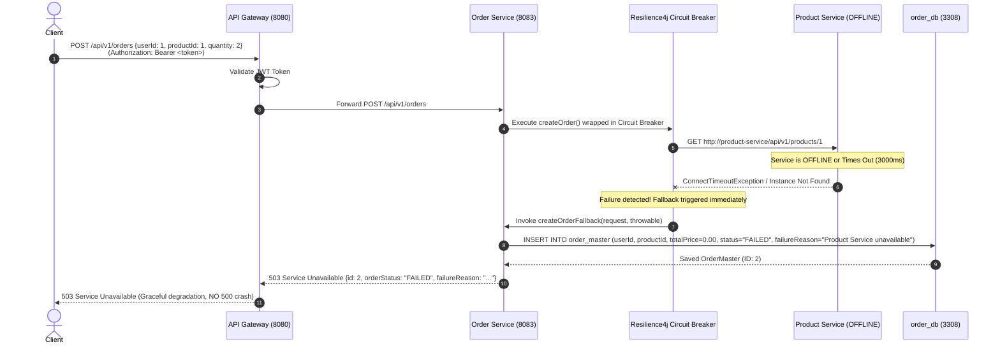
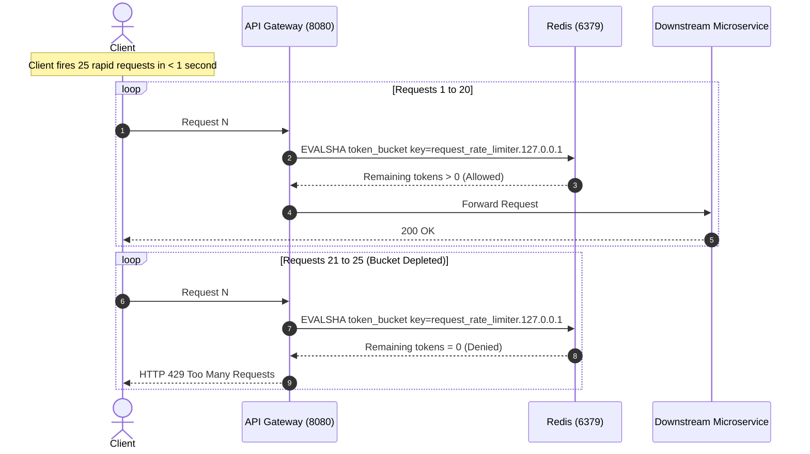
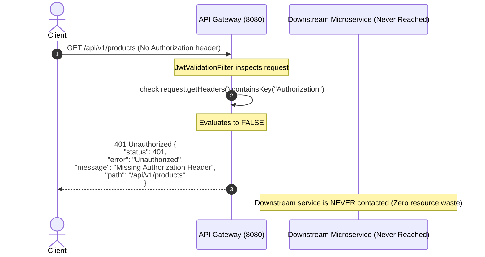

# Enterprise Microservices: Architecture & Complete Endpoint Flow Diagrams

This document provides architectural breakdowns of every microservice and detailed sequence diagrams for **every endpoint flow** in the system.

---

## 1. High-Level System Architecture & Component Roles

---

## 2. In-Depth Service Responsibilities

### 1. `service-registry` (Eureka Server, Port 8761)
- **Role**: Central address book of the entire microservices ecosystem.
- **How It Works**:
  - Every microservice on boot reads `eureka.client.service-url.defaultZone` and sends its application name (`spring.application.name`), container IP, port, and health check URL.
  - Services send a **heartbeat every 30 seconds**. If Eureka misses heartbeats beyond the lease expiration threshold, it evicts the instance.
  - Client services (`api-gateway`, `order-service`) pull the registry table periodically and cache it in-memory. They do **not** query Eureka on every HTTP request.

### 2. `api-gateway` (Spring Cloud Gateway, Port 8080)
- **Role**: Perimeter reverse proxy, security enforcement boundary, and traffic controller.
- **Key Modules**:
  - **Reactive Non-Blocking Engine**: Runs on Project Reactor / Netty (no thread-per-request overhead).
  - **Dynamic Routing**: Uses `lb://<service-name>` to balance traffic across healthy instances discovered via Eureka.
  - **`JwtValidationFilter`**: Intercepts secured routes (`/api/v1/products/**`, `/api/v1/orders/**`). Cryptographically validates HMAC-SHA256 signature and expiration date. Rejects unauthorized requests with clean JSON 401s.
  - **Downstream Header Propagation**: Injects authenticated identity (`X-Auth-User-Email`, `X-Auth-User-Role`) into downstream requests.
  - **`RequestRateLimiter`**: Backed by Redis token buckets (10 req/sec limit, 20 burst capacity) keyed by client IP (`ipKeyResolver`).

### 3. `user-service` (Identity & Authentication, Port 8081)
- **Role**: User persistence, credential verification, and cryptographic token issuance.
- **Database**: `user_db` (MySQL Port 3309).
- **Key Modules**:
  - Spring Security 6 stateless filter chain.
  - BCrypt password encoder (one-way salt + hash).
  - `JwtService`: Signs tokens using HMAC-SHA256 with 24-hour expiration containing claims `sub` (email) and `role` (`ROLE_USER`).

### 4. `product-service` (Domain Service, Port 8082)
- **Role**: Catalog management and real-time inventory tracking.
- **Database**: `product_db` (MySQL Port 3307).
- **Key Modules**:
  - Spring Data JPA `ProductRepository`.
  - `@RestControllerAdvice` converting `ResourceNotFoundException` to clean JSON 404 responses.
  - Supplies inventory data to `order-service` via internal endpoints.

### 5. `order-service` (Business Orchestrator, Port 8083)
- **Role**: Transaction management, order placement, and cross-service orchestration.
- **Database**: `order_db` (MySQL Port 3308).
- **Key Modules**:
  - OpenFeign Client (`ProductClient`): Interacts with `product-service` dynamically.
  - `FeignClientConfig` (`RequestInterceptor`): Extracts the JWT Bearer token from the incoming request's `RequestContextHolder` and attaches it to the outgoing Feign request.
  - Resilience4j Circuit Breaker (`@CircuitBreaker(name = "productService", fallbackMethod = "createOrderFallback")`): Gracefully catches downstream timeouts, marks order status as `FAILED`, and records diagnostic failure reasons.

---

## 3. Detailed Endpoint Sequence Diagrams

---

### Flow 1: User Registration (`POST /api/v1/auth/register`)
**Type**: Public Route (No Token Required)

---

### Flow 2: User Login (`POST /api/v1/auth/login`)
**Type**: Public Route (Credential Verification & Token Issuance)

---

### Flow 3: Product Creation (`POST /api/v1/products`)
**Type**: Secured Route (Gateway JWT Validation Filter + Redis Rate Limiter)

---

### Flow 4: Get Product by ID (`GET /api/v1/products/{id}`)
**Type**: Secured Route with 404 Exception Handling

---

### Flow 5: Order Creation — Happy Path (`POST /api/v1/orders`)
**Type**: Secured Route + OpenFeign Call + Inter-Service JWT Propagation

---

### Flow 6: Order Creation — Resilience4j Circuit Breaker Fallback
**Type**: Triggered when `product-service` is DOWN, times out, or instances drop from Eureka

---

### Flow 7: Redis Rate Limiting Flow (`HTTP 429 Too Many Requests`)
**Type**: Anti-Abuse & DDoS Protection at Perimeter

---

### Flow 8: Unauthorized Access Flow (`HTTP 401 Unauthorized`)
**Type**: Gateway JWT Validation Filter Interception

---

## 4. Summary Table of All Endpoints & Filter Behaviors

| HTTP Method | Gateway Path | Route ID | Target Microservice | Filters Applied | Rate Limited? | Auth Required? | Expected Status Codes |
| :---: | :--- | :--- | :--- | :--- | :---: | :---: | :---: |
| `POST` | `/api/v1/auth/register` | `user-service-route` | `lb://user-service` | `RequestRateLimiter` | Yes (10/s) | No (Public) | `201`, `400`, `409`, `429` |
| `POST` | `/api/v1/auth/login` | `user-service-route` | `lb://user-service` | `RequestRateLimiter` | Yes (10/s) | No (Public) | `200`, `400`, `401`, `429` |
| `POST` | `/api/v1/products` | `product-service-route` | `lb://product-service` | `JwtValidationFilter`, `RequestRateLimiter` | Yes (10/s) | **Yes** | `201`, `400`, `401`, `429` |
| `GET` | `/api/v1/products/{id}` | `product-service-route` | `lb://product-service` | `JwtValidationFilter`, `RequestRateLimiter` | Yes (10/s) | **Yes** | `200`, `401`, `404`, `429` |
| `GET` | `/api/v1/products` | `product-service-route` | `lb://product-service` | `JwtValidationFilter`, `RequestRateLimiter` | Yes (10/s) | **Yes** | `200`, `401`, `429` |
| `POST` | `/api/v1/orders` | `order-service-route` | `lb://order-service` | `JwtValidationFilter`, `RequestRateLimiter`, OpenFeign Interceptor, Resilience4j | Yes (10/s) | **Yes** | `201`, `400`, `401`, `429`, `503` (Fallback) |
| `GET` | `/api/v1/orders/{id}` | `order-service-route` | `lb://order-service` | `JwtValidationFilter`, `RequestRateLimiter` | Yes (10/s) | **Yes** | `200`, `401`, `404`, `429` |
| `GET` | `/api/v1/orders` | `order-service-route` | `lb://order-service` | `JwtValidationFilter`, `RequestRateLimiter` | Yes (10/s) | **Yes** | `200`, `401`, `429` |

